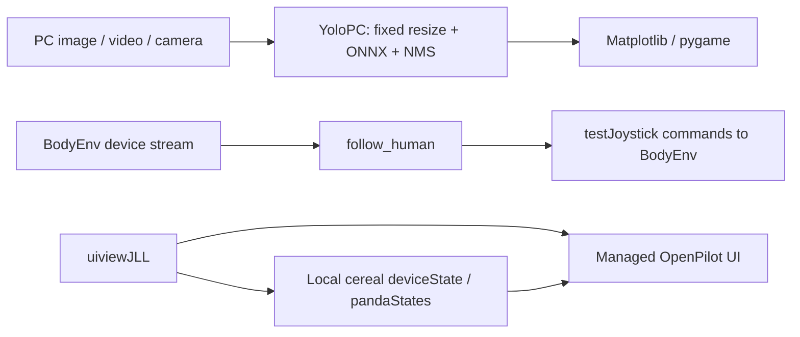
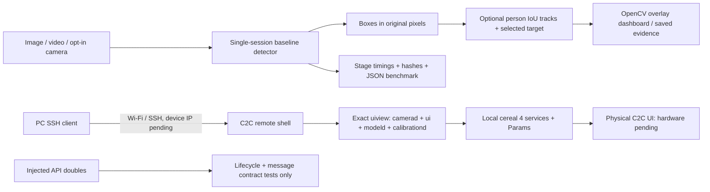

# Project 3 — AI Robot / Run1–2

Historical audit baseline (2026-10-14, Asia/Taipei). Repository root:
`/Users/2006wu/Desktop/ai-self-drive-car-ws`; branch `develop`; starting HEAD
`0098f886e078cacbe08eb2d1282922cd78b5b1dc`; initial tracked/untracked status clean.
These identifiers describe the original audit, not the current checkout.
Professor source and P1/P2 environments remain references.

## Current software status (2026-10-21)

Run1 image/video, tracking/overlay and benchmarks are implemented. Completed
software/offline extensions: `kalman_iou` plus synthetic tracker benchmark;
MOT/CVAT import and `evaluate --trackers all`; webcam/network `stream:` input
with latest-frame reading; PID follow and `pid_sim`; `p3_control_dataset/1.0`;
ridge/MLP BC; the SafetySupervisor 1.0 m width-based too-close hard stop (zero
forward speed, no reverse); mock/dry-run body interface with watchdog, e-stop
latch and rate/acceleration limits (real transport refused); `real_session`
export, `run2_acceptance` and pipeline measurements; `report3_figures`.
All control output is **simulation_only** and never sent to physical hardware.

Current local verification: **286 tests, OK (skipped=8)**. The user reported a
Mac `develop` **131faef** full health check passing **472 tests across projects**,
including **276 Project 3 tests at that time**, and stream software STOP about
**0.05 s after SIGINT**. Historical evidence counts are revision-specific.
Docker via `./scripts/dev.sh` is the supported runtime; this documentation check
used the user-authorized existing Linux venv because Docker is unavailable.

Remaining user/hardware-only work: Run2 real-car session and acceptance; real
multi-person CVAT annotation/evaluation; manual `q/c/n/r/s` with `--display`;
online Gemini call (API key); Report 3 write-up/slides due **2026-12-25**.
Run2 continuity needs reviewed `target_identity` annotation. Physical C2C/comma
body control is unimplemented by design and needs a separate safety review.
See [current status](../projects/project3/evidence/STATUS.md) and the
[ordered command guide](../projects/project3/README.md).

## Professor requirements and scope

Evidence: local `course-materials/2609 AI Course Notes.docx`, Project 3 entry;
`course-materials/2603 MR Projects.docx`, Run1/Run2 paragraphs and Appendix.
Original documents remain local, excluded from Git. Requirements below paraphrase
rather than redistribute the originals. P1/P2 current status was checked in root
README, docs index, IMPLEMENTATION, INSTALLOP audit/assets, PROJECT2 and latest
PROJECT2_AUDIT / EXPERIMENT_LOG entries, and component execution READMEs.

| Requirement | Source | Classification / confidence | Dependencies | Acceptance | Status at audit start |
|---|---|---|---|---|---|
| Project 3 covers Run1–2 | Course Notes, Project 3 | Required / course confirmed | MR Projects | Separate Run1/Run2 evidence | Scope confirmed |
| PC executes YoloPC.py derived from FH | MR Projects, Run1 | Required / course confirmed | PC, model, Python dependencies | YOLO runs with visible boxes | NOT RUN |
| Default image workflow | YoloPC.py main → run1 | Source confirmed; exact example image absent | preview.png | Image inference + original/student comparison | Missing preview.png |
| Video and PC camera modes | YoloPC.py run2/run3/run4 | Source options; engineering coverage, not separately mandated by course sentence | video/camera | EOF, boxes, close resources | NOT RUN |
| YOLOv5n flat model, 640×416 | YoloPC.py and existing ONNX | Source confirmed, preserve baseline model | ONNX/ORT/OpenCV | Actual model IO + numerical parity | NOT RUN |
| C2C with Wi-Fi and uiview.py | MR Projects, Run2 | Required / course confirmed | Physical C2C, network, specified script | Device UI demo with logs | Hardware availability unknown |
| Wi-Fi/SSH setup reading | MR Projects, Read2 | Course reference | Wi-Fi, SSH keys | Document device-specific steps | Hardware pending |
| UI placement / exact Run2 protocol | Retrieved exact uiview.py comments and main | Source confirmed: UI on C2C; PC SSH over Wi-Fi, local cereal on device | Actual device firmware still unknown | Device UI and processes | Static confirmed; hardware pending |
| Simultaneous YOLO and UI in Run2 | No explicit instruction found | Unknown; not established as required | More source/device evidence | Confirm before integration | NOT CONFIRMED |
| PID, CB, C3X/C4, physical following | MR Projects Run3–5/New | Later extensions, outside Run1–2 | Additional hardware/control | Separate future acceptance | OUT OF SCOPE |
| Benchmark, tracking, dashboard | User request | Engineering / Extensions | Run1 verified | Quantified repeatable evidence | NOT RUN |

Course hardware overview lists different OP/DP/LP versions for different devices;
it does not establish the user's actual C2C firmware. Do not install PC OP091 onto
C2C or choose a device version from that overview without device inspection.

## Source audit

| Reference | Purpose / data flow | Environment and dependencies | Network / hardware | Errors and limits / reuse |
|---|---|---|---|---|
| external/aJLL/bodyjim/YoloPC.py | image/video/camera → resize → ONNX → NMS → plots/pygame; optional printed action | cv2, numpy, onnx, ORT, matplotlib, pygame | default image is local; camera optional; no robot actuation in this file | hardcoded image/video paths; missing urllib import if model absent; per-frame session reload in runYolo; video EOF loop; camera boxes remain model-space; metadata assumes first entry; reuse baseline math in student adapter |
| external/aJLL/bodyjim/follow_human.py | BodyEnv driver frame → YOLO → largest confident person → env.step | additionally gymnasium, aiohttp, aiortc, teleoprtc via bodyjim | HTTP :5001 /stream + /schema, WebRTC video/data channel; testJoystick axes output | controls physical hardware; no execution here; not a Run2 protocol specification |
| external/aJLL/bodyjim/yolov5n_flat.onnx | preserved model, not retrained/replaced | IO/metadata audited by independent environment | none | exact SHA and IO in generated model audit |
| external/aJLL/UI/uiviewJLL.py | start managed ui; publish started deviceState and ignition pandaStates at ~100 Hz | cereal/log/messaging + managed_processes in compatible OpenPilot Linux | local cereal IPC, no explicit Wi-Fi peer, port or video bridge | handles KeyboardInterrupt only; failures before try can leak UI; no general cleanup; no camerad/modeld started |
| external/aJLL/UI/uiviewJLL1.py | same active behavior as JLL file | same | same | compare active code rather than infer from filename |
| specified uiview.py (downloaded into ignored artifacts/reference) | Writes CarParams(notCar=True); starts camerad/ui/modeld/calibrationd; publishes controlsState/deviceState/pandaStates/carParams | device-compatible cereal, common.params, managed_processes, device model binaries | C2C hardware; PC SSH/Wi-Fi management; no network server in main | Persistent Params write before try; incomplete cleanup on startup error; AST exercised with injected API doubles only |

YoloPC baseline confidence is objectness, class = argmax class score; NMS is
class-agnostic. Student baseline preserves these semantics and BGR preprocessing.
Scores are explicitly labeled objectness, not calibrated class probability.
Changing to objectness×class or RGB is a separate experiment, not a silent fix.
Camera output boxes must be scaled independently by original width/640 and
height/416. Preserve direct resize for baseline parity; letterboxing changes inputs.

## Architecture

Actual local reference paths (not claimed as jointly operating):

Student design after audit:

No Run1-to-Run2 network bridge is established by the course evidence. A mock
must target a confirmed existing interface, not invent a TCP/UDP service.

## Dependencies / hardware / risks

Use the dedicated Python 3.11 Project 3 Docker service via `./scripts/dev.sh`,
with CPU ORT as the baseline. Inspect actual execution providers; availability
is not speed or GPU-offload evidence. CoreML is unavailable in Linux Docker.
The opt-in Mac ffmpeg/AVFoundation bridge supplies `stream:` input, subject to
macOS camera permission; inference and tests stay in Docker. Keep Python 3.8
ModelB6/OpenPilot separate from Python 3.11 Agent/Project 3 and preserve volumes.

Risks: absent preview image; model preprocessing convention; confidence semantics;
ONNX fixed shape; camera permission; hardware/firmware unknown; local cereal ABI
incompatible with device version; UI fake ignition must not share live replay IPC;
IoU tracking loses identity after crossings/long occlusions. No ground truth means
no precision/recall/mAP claim. Original restricted course assets are never published.

## Acceptance and development roadmap

1. P3.0: verify scope/source and retrieve exact uiview; log unknowns.
2. P3.1: isolated Python 3.11 Docker runtime, pinned dependencies, environment validation.
3. P3.2: image → video → opt-in camera; preserve model preprocessing/NMS baseline;
   verify IO, coordinate mapping, single-session use, EOF/error cleanup.
4. P3.3: bounded warm-up benchmark over fixed image/video/resolution/threshold/provider
   scenarios; stage mean/median/P95/std/count; report memory and confidence; no mAP.
5. P3.4: exact Run2 static audit; only interface-compatible mock if justified.
6. P3.5: hardware checklist; no external device modification without authorization.
7. P3.6: after Run1 model/image/video verification, add IoU person tracking and
   OpenCV overlay; test synthetic association separately from real tracking quality.
8. P3.7–8: save commands, test logs, source/model/input hashes, report-ready status.

Verification states: PASS / FAIL / SKIP / BLOCKED / NOT RUN. SKIP/BLOCKED/NOT RUN
never count as PASS. Final matrix and observed metrics are maintained in
`projects/project3/evidence/STATUS.md` after actual execution.

## Confirmed Run2 source comparison and revised decision

Exact script retrieved successfully using the course-linked Drive file ID; SHA,
byte length, imports and process lists are in `evidence/source-audit.json`. Its
comments specify executing from the **C2C remote shell**; its main starts four
managed processes, writes persistent CarParams and publishes four local services.
JLL starts UI only, publishes two services, and does not write CarParams. They
are different implementations, not interchangeable versions for this task.
No Run1 YOLO connection is present; modeld here uses the device's model pipeline.
Do not infer network video streaming from the source's historical PC-video try.

Engineering decision: `p3/run2.py` is a minimal dependency-injected lifecycle
adapter preserving those APIs/fields, with bounded retries and cleanup. Its mock
is an API double, not a Wi-Fi/SSH emulator or serialized cereal peer. Normal data,
invalid data, send timeout, disconnection, publisher recreation and cleanup are
exercised. Actual transport and real UI tests remain pending. Unknown device
schema/firmware prevents an honest claim of hardware-ready integration.

## Tracking method decision (extension)

Compared a minimal IoU association baseline, [SORT](https://github.com/abewley/sort)
(Kalman prediction + assignment), and [ByteTrack](https://github.com/FoundationVision/ByteTrack)
(high/low score association). Selected dependency-free one-to-one greedy IoU
association for the first measurable extension; preserves the existing detector
and avoids adding a training/embedding framework. This is **not** SORT/ByteTrack.
It preserves IDs over short overlapping-box gaps, reports missing/lost targets,
and permits explicit target cycling. The production baseline has no motion
prediction or appearance features: crossings, fast motion and longer occlusion can switch IDs. Offline
research now also offers Hungarian assignment and `kalman_iou` motion prediction,
with a synthetic benchmark and opt-in three-tracker annotated comparison. Synthetic
association tests pass; real human tracking accuracy is not measured. Track ID
is not person identity, and there is no physical human-following control.

[ORT CoreML documentation](https://onnxruntime.ai/docs/execution-providers/CoreML-ExecutionProvider.html)
was consulted; provider enumeration, actual session creation and measured file
benchmarks determine this installation's result. CoreML used CPU fallback for
some nodes. No GPU utilization/offload-only or cross-machine speed claim.

## Current verification

See [acceptance/evidence status](../projects/project3/evidence/STATUS.md),
[reproducible commands](../projects/project3/README.md) and
[hardware checklist](../projects/project3/HARDWARE.md). The original example
preview.png is absent, so student sample-image execution plus pure-function
numeric parity does not claim running the unchanged professor interactive GUI.

## User hardware scope update

The user confirmed no available/confirmed physical C2C for this phase and asked
to finish software first. Continue independent software work; defer device
Wi-Fi/SSH/UI verification. API-double success does not complete Run2 Level C.

## Evidence snapshots and Run2 measurements

The [2026-10-16 report](../projects/project3/evidence/validation-20261016/REPORT.md)
records 107 tests at that revision; it remains immutable historical evidence.
The [Docker report](../projects/project3/evidence/docker-20261021/RESULTS.md)
likewise retains its original test count. Use the current status above for the
present code, and keep synthetic results separate from real acceptance.

New pipeline journals log acquisition/decision age, `too_close`, `safety_stop`
episodes, `operator_stop` and cumulative latest-frame replacement counters.
`run2_acceptance` consumes these automatically; old logs may need a measurement
sidecar. Stop latency needs an actual operator-stop onset and final zero command;
tracker continuity always needs reviewed human `target_identity` annotations.
These are software timings and identity annotations, never actuator feedback.
The full [hardware checklist](../projects/project3/HARDWARE.md) remains pending.
