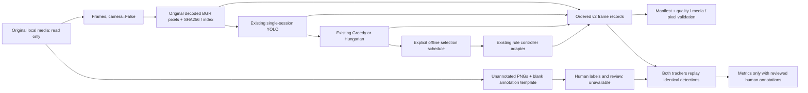

# Milestone 2 — Synchronized Dataset & Tracking Evaluation

Date: 2026-10-20, Asia/Taipei. Branch **develop**. HEAD **9a864c546f5121748079ad58df2879faf8ffb46c**. No commit/push/merge/branch changes.

**IMPLEMENTED / TESTED:** an isolated offline recorder, new v2 dataset contract and quality/integrity checks, blank human-annotation workflow, and identical-input comparison of the existing Greedy IoU and Hungarian trackers. **BLOCKED:** real tracking accuracy because no valid reviewed human annotations were available. No model training, camera, hardware or original runtime integration was performed.

## 1. Inspection, preservation and architecture

Read the existing Milestone 1 `reports/ai-control-readiness-20261020/REPORT.md`, research controller/schema/export/tracker/comparison modules, Project 3 capture/detection/selection/follow pipeline, tracking evaluator and authored scenarios, original test files and `test_research.py`, requirements and verification scripts, existing evidence and local media inventory. Exact reusable contracts and preimplementation decisions are in [PLAN.md](PLAN.md), created before source additions. No AGENTS.md found.

Initial working tree already contained Milestone 1's untracked `p3/research/`, `test_research.py` and report directory. All were preserved. A 455-file preimplementation snapshot includes existing tracked/untracked files, professor assets, course material and Project 3 source/output media, excluding generated bytecode. Final preservation checks compare against this snapshot, not an older historical manifest.



Original `p3.cli`, pipeline, Tracker, FollowController, Run2, schema v1.0 and Milestone 1 exporter remain byte-identical. No new module is imported into the existing CLI. The new entry point is `python -m p3.research.offline`. There are no camera flags, device bindings, sockets, SSH or motor APIs in this path. The only source interface is an existing local media file, always passed to Frames with camera=False.

## 2. Files created and modified

Existing files modified: **NONE**, including the uncommitted Milestone 1 sources/tests/reports.

New sources:

- `projects/project3/p3/research/dataset_v2.py`: versioned validation, canonical encoding, stable identity and integrity/quality verification.
- `projects/project3/p3/research/recorder.py`: ordered local-file recorder and provenance/manifest production.
- `projects/project3/p3/research/annotations.py`: blank template, human annotation contract and original-frame extraction.
- `projects/project3/p3/research/evaluate_dataset.py`: identical-input dual tracker replay, optional reviewed annotation metrics and coverage.
- `projects/project3/p3/research/offline.py`: standalone record/validate/template/extract/validate-annotations/evaluate commands.
- `projects/project3/tests/test_milestone2.py`: 26 new offline tests.

New documentation/evidence are confined to this report directory. See the generated file list in checks.json for all artifacts. Main deliverables are [SCHEMA.md](SCHEMA.md), [ANNOTATION_WORKFLOW.md](ANNOTATION_WORKFLOW.md), usa-verified/, image-sample/, original decoded annotation-frames/, blank annotation-template.json, quality reports, synthetic-tracking.json, unannotated tracking results and test/preservation logs. usa-sample/ is a retained preliminary recording from before the final validator refinements; use **usa-verified/** for the final reproduction recipe. No historical evidence was overwritten or deleted.

## 3. Dataset schema and stable identity

New version: **comma_body_research/2.0**, with bundle version **comma_body_bundle/2.0**. This is intentionally separate from v1.0 because full original-frame references, processing stage times and new timestamp semantics are required. v1 still rejects v2, and existing v1 export tests continue to pass. v2 reuses v1 category/box/unit validation internally, with independent v2 timestamp checks.

Each sequential record associates the original media hash and decoded index, BGR pixel hash, dimensions, all YOLO observations, all person tracks, selected tracker target, controller target, explicit selection operation and the complete original FollowController decision. Provenance distinguishes observations from normalized rule pseudo-labels. Human demonstrations, physical measurements, emergency-stop state and ground truth remain explicitly missing; human annotations are a separately validated artifact. Detections are not labels and tracking IDs are not human identities.

Logical session ID hashes original media bytes, detector/model configuration, decoder versions, tracker/controller settings, frame bound, selection schedule and implementation fingerprints. It is stable for the same processing recipe. Frame IDs are contiguous zero-based decode indices. Measured processing time and resulting journal checksum are deliberately not identity inputs. Stable IDs do not guarantee byte-identical measured times or decisions affected by real staleness. Exact annotation binding includes the journal hash. See [SCHEMA.md](SCHEMA.md) for fields, units, missing-data policy and relocation/decoder limits.

## 4. Recorder implementation and timestamp semantics

Reuse: Frames(path,camera=False), Detector.predict, create_tracker, RuleBasedController, original FollowController behavior. YOLO remains BGR/direct resize/objectness/class-agnostic NMS with a single local ONNX session. Default research tracker is greedy. Optional Hungarian uses the preserved implementation. No Kalman or Re-ID was added.

A recording exclusively creates a new output directory. It fingerprints original encoded media and decoded pixels, processes frames sequentially, flushes each JSONL row, validates ordering/content and rechecks the source hash before creating a completed manifest. Failure retains a failure marker and partial journal with simulated final STOP; failed/incomplete bundles are rejected. Successful manifests include original final STOP separately, without inventing a frame for it.

Processing uses one monotonic perf_counter origin. read_start/decode_end/detection_end/tracking_end/decision_end measure actual local work. `timestamp.semantics=processing_complete` denotes decision-stage completion, before validation/journal export; it is **not exposure or capture time**. Explicit missing capture_timestamp records why none is available. Controller age is the measured tracking_end-read_start interval, so slow processing can trigger the original stale-frame STOP. FPS/PTS are not converted to fake exposure times.

Selection schedule is opt-in and maps decoded indices to visible tracker IDs, or null to cancel. Default controller remains IDLE even if tracker auto-selects a target. Explicit select first yields the original zero decision; later updates may FOLLOW only under the original state machine. No automatic rearm after loss/overlap/fault is introduced. A supplied schedule is an offline operator selection instruction, never a human velocity demonstration.

## 5. Executed local recordings

Available Project 3 videos are listed in local-media-inventory.json. Only `artifacts/inputs/usa.hevc` is an original local input; the other listed AVI files are previously rendered overlays and were not used as original camera data. Docker-held datasets were not accessed. The existing local bus.jpg is a public single-image fixture, not annotated tracking ground truth.

| Dataset | Frames | Detections | Person detections / visible tracks | Selection | Termination | Integrity |
|---|---:|---:|---:|---|---|---|
| usa-verified | 120 | 865 | 0 / 0 | None; controller IDLE | frame_limit + final STOP | Encoded source, journal and all decoded pixels PASS |
| image-sample | 1 | 5 | 4 / 4 | Explicit track 1 on frame 0 | EOF + final STOP | Encoded source, journal and decoded pixels PASS |

The image selection produced TARGET_SELECTED with zero output; no temporal follow claim follows from one image. Road data has no detected people in this window and does not validate person association or recovery. The injected multi-frame controller tests, not road video, exercise follow/cancel/stale behavior.

USA final logical session: `offline-10f3ef633c32c5084106bbb58788d207bb2fe88bc79bef4617a155c3130564c6`. Journal SHA256: `68007807c9acf59d5d5d5edcd08e4d2968197ece4b8eceb1273bcd45cdbf8762`.

Image logical session: `offline-6e1c61a8b2e143ea686bb4bbec2e9690e27d2fbb660b7191f7ffde1ae4a66b36`. Journal SHA256: `fb4998f617c3b6f91b1bd8bf0a615a802c1d2a0da2fd64d8eaa14f29919e1f83`.

## 6. Data integrity and quality

**TESTED:** required fields, finite/ordered processing timestamps, contiguous frame ordering and duplicate rejection, original media references/dimensions/pixel identity, valid boxes, control metadata/source/status/units, label provenance separation, invalid JSON/duplicate keys/corrupt records, missing or modified source media and tampered journals. Optional pixel verification catches pixel-fingerprint changes even if the journal checksum is recomputed. Tests also reject reverse clocks, source/destination overwrite, detector pixel mutation and partial failure bundles. Relevant source hashes in both final manifests match the delivered implementation.

Quality reports are produced automatically for successful recordings and by standalone validate (PASS or FAIL with errors). `usa-quality-verified.json` and `image-quality-verified.json` additionally verify original decoded pixel identity. Hashes provide integrity, not independent authenticity or annotation truth. A party rewriting both data and manifests is outside the checksum threat model. Media references are external; keep originals available. The decoder environment must reproduce pixels for strict verification. The current bounded recorder buffers rows for final validation; it is not a scalable streaming data lake.

## 7. Human annotation workflow

**IMPLEMENTED / TESTED:** source-bound blank templates, original unannotated PNG extraction, persistent positive human person IDs, pixel boxes, occlusion none/partial/full, nullable box only for full occlusion, frame IDs and references, independent target human identity, annotator/reviewer/reference provenance and reviewed state. Supplied annotation-template.json contains 120 empty unreviewed frames. annotation-frames/ contains five genuine decoded frames and a separate five-frame blank template. No predicted boxes are copied into either template.

**BLOCKED:** actual human annotation/review. Setting flags is not evidence of correct labels; provenance and review remain human responsibilities. The small authored annotation values inside automated tests are explicitly test-only fixtures, never exported as real human evidence.

Metrics use reviewed frames only, while trackers process all recorded frames. Sparse annotation coverage is reported. Full occlusion without a trustworthy box is excluded from GT box matching, while predictions can still count as unmatched; there is no invented ignore region. Recovery/fragmentation cover the sampled sequence and the original evaluator's definitions. See [ANNOTATION_WORKFLOW.md](ANNOTATION_WORKFLOW.md) for step-by-step labeling and commands.

## 8. Tracking evaluation

**IMPLEMENTED / TESTED:** both methods replay exactly the same stored detections, with a shared input SHA256 and the same threshold=.3/max_missed=5. Five complete warm-up replays precede 30 measured replays; latency is tracker.update only. It excludes media decode, detection, hashing, annotation and evaluator work. Saved synthetic metrics retain their synthetic_ground_truth category; real data never borrows those labels.

Without valid human annotations, `metrics=null` for each method, with BLOCKED status. Thus real-data ID switches, IDF1, fragmentation and recovery are **N/A**, not zero. Latency on USA is dominated by no-person input; image timing measures initialization of four tracks on a single frame, not trajectory association. Machine/load effects and some concurrently running software checks preclude broad performance claims.

| Real input | Method | Mean / P95 tracker ms | Measured updates | Identity metrics |
|---|---|---:|---:|---|
| USA120, no persons | greedy_iou | 0.008561 / 0.013292 | 3600 | N/A — no reviewed human annotations |
| USA120, no persons | hungarian | 0.009257 / 0.013416 | 3600 | N/A — no reviewed human annotations |
| Bus image, initialization only | greedy_iou | 0.010026 / 0.010614 | 30 | N/A — no reviewed human annotations |
| Bus image, initialization only | hungarian | 0.010558 / 0.010975 | 30 | N/A — no reviewed human annotations |

Synthetic regression comparison (existing authored fixtures):

| Fixture | Greedy / Hungarian switches | IDF1 (both) | Fragments (both) | Target recovery (both) | Greedy / Hungarian mean tracker ms |
|---|---:|---:|---:|---:|---:|
| A_left | 0 / 0 | 1.0000 | 0 | N/A | 0.02145 / 0.02621 |
| A_right | 0 / 0 | 1.0000 | 0 | N/A | 0.02157 / 0.02618 |
| A_approach | 0 / 0 | 1.0000 | 0 | N/A | 0.02156 / 0.02589 |
| A_recede | 0 / 0 | 1.0000 | 0 | N/A | 0.02239 / 0.02606 |
| A_short_exit | 0 / 0 | 1.0000 | 0 | 1.0 | 0.01877 / 0.02604 |
| B_simultaneous_opposite | 0 / 0 | 1.0000 | 0 | N/A | 0.07897 / 0.05420 |
| B_crossing | 2 / 2 | 0.5476 | 0 | N/A | 0.08157 / 0.05573 |
| B_close_parallel | 0 / 0 | 1.0000 | 0 | N/A | 0.07982 / 0.05494 |
| B_partial_overlap | 0 / 0 | 1.0000 | 0 | N/A | 0.07995 / 0.05467 |
| C_short_occlusion | 0 / 0 | 0.9268 | 1 | 1.0 | 0.01889 / 0.02514 |
| C_long_occlusion | 1 / 1 | 0.4348 | 1 | 0.0 | 0.01356 / 0.02056 |
| C_occluded_separation | 2 / 2 | 0.4675 | 2 | 0.0 | 0.06518 / 0.05103 |

No synthetic identity metric improved. Crossing still has **2 switches**, IDF1 **0.5476**, in both trackers; long occlusion still expires the initial ID. Default remains greedy. This evidence does not justify adding Kalman or Re-ID in this milestone.

## 9. Tests and preservation

| Executed check | Result | Evidence |
|---|---|---|
| Baseline original P3 + Milestone 1 | 130 PASS, 0 FAIL, 0 SKIP | baseline-tests.txt |
| Final full P3 | 156 PASS, 0 FAIL, 0 SKIP (130 preserved + 26 new) | final-tests.txt |
| First new-test pass | 23 PASS before final three boundary/CLI cases | new-tests-first.txt |
| Relevant Project 2 offline agents | 96 PASS, 0 FAIL | project2-tests.txt |
| Real local model/image/video | 1 image and 120 video frames recorded, source/journal/pixel verification PASS | final bundle/quality files |
| Synthetic tracking regression | All 12 existing fixture metrics reproduced; both trackers retain known limitations | synthetic-tracking.json |
| Environment | pip check: no broken requirements | checks.json |
| Existing content preservation | Initial 455-file snapshot compared without any changed/missing file | preservation-after.json |
| Existing runtime/CLI/v1/Milestone 1 | Byte-identical; default interfaces unchanged | preservation manifests, git diff |

No physical hardware operation, network change, source media write, professor-source modification, Docker volume change, AI training, model replacement/download, API call, commit or push was part of the executed workflow. Project 2 checks cover its relevant offline agent suite, not TensorFlow retraining or live API acceptance. Generated test fixtures are temporary repository-local files removed by the tests; no historical artifacts are deleted.

## 10. Reproduction

From repository root, reuse the existing local environment and choose new outputs. Defaults are a bounded 120-frame recording with greedy tracking and no controller selection. Missing local model/input fails without downloading. Existing destinations are refused.

```sh
PYTHONPATH=projects/project3 projects/project3/.venv/bin/python -m p3.research.offline record projects/project3/artifacts/inputs/usa.hevc --max-frames 120 --output reports/my-new-offline-dataset
PYTHONPATH=projects/project3 projects/project3/.venv/bin/python -m p3.research.offline validate reports/my-new-offline-dataset --verify-pixels --output reports/my-new-quality.json
PYTHONPATH=projects/project3 projects/project3/.venv/bin/python -m p3.research.offline template reports/my-new-offline-dataset --output reports/my-new-annotation-template.json
PYTHONPATH=projects/project3 projects/project3/.venv/bin/python -m p3.research.offline evaluate reports/my-new-offline-dataset --output reports/my-new-unannotated-comparison.json
PYTHONPATH=projects/project3 projects/project3/.venv/bin/python -m p3.research.compare reports/my-new-synthetic-comparison.json
PYTHONPATH=projects/project3 projects/project3/.venv/bin/python -m unittest discover -s projects/project3/tests -v
projects/project2/agent/.venv/bin/python -m unittest discover -s projects/project2/agent -p '*_tests.py' -v
```

Optional `--tracker hungarian` selects the preserved experimental tracker in the standalone recorder only. Optional `--selection-schedule PATH.json` reads canonical nonnegative decimal frame keys mapped to a visible positive track ID or null for cancellation. A schedule never supplies a person identity or motor demonstration. See image-selection.json for the executed frame-0 selection; the automated tests cover select/follow/cancel/reselect/stale behavior without hardware.

The evaluate command can successfully write a BLOCKED report when labels are absent; that exit is report generation success, not accuracy acceptance. validate and validate-annotations exit nonzero on invalid data or draft annotations. Every output uses exclusive creation. Timing values differ per run; deterministic order and logical identifiers do not assert deterministic real-time measurements.

## 11. Remaining limitations and status boundaries

- **IMPLEMENTED:** offline synchronized observation/decision recording, v2 contract, integrity/quality checks, annotation tooling, dual-method replay comparison.
- **TESTED:** local model/image/bounded video, pixel association, exact original controller behavior in injected sequences, order/corruption/provenance failures, original/P2 offline regressions and preservation.
- **DESIGNED:** manual annotation/review protocol, dataset relocation, downstream training data selection; no model or physical interface is implemented by this milestone.
- **BLOCKED:** valid reviewed real multi-person trajectory annotations and target identity; current road sample has no detected people. Meaningful real person-tracking accuracy needs a suitable original clip and human labels.
- **NOT TESTED:** hardware/camera exposure timing, cross-device synchronization, motors, odometry, body dynamics, closed-loop stability, physical safety, large multi-session scaling and real human annotation agreement. No calibrated SI control or human driving demonstrations exist here.

Existing native capture can block; the bounded frame count is not a hard watchdog. Unknown-length decoder EOF can hide truncation, inherited from Frames. The dataset is a bounded single-media logical session, not a cross-camera clock synchronizer. Target box may be the last known missing-track box, explicitly accompanied by track state. Integrity cannot prove that a detector found every person, that a human is correctly identified, or that labels are truthful. No timestamp is converted into camera exposure time.

## 12. Recommended Milestone 3

**Human-reviewed multi-person tracking benchmark**, still offline: obtain a suitable original multi-person clip with crossings/short and long occlusions, preserve media provenance, record it with this tool, annotate a short dense frame sequence, review persistent identities/occlusion/target identity, and publish a quality/coverage receipt tied to the exact dataset journal. Then compare Greedy/Hungarian on identical detections and predeclare acceptance thresholds, report failures and latency, and decide from real evidence whether motion prediction is justified. Measure annotation agreement on difficult cases. Do not add training or hardware actuation merely to advance the milestone number.
