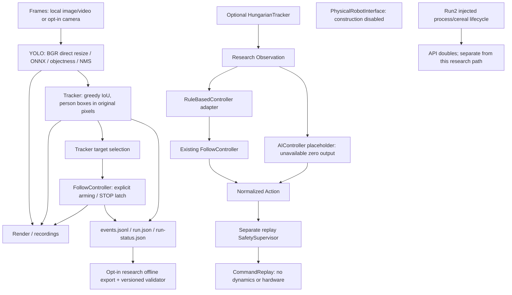

# AI-Control and comma body Dataset Research Readiness Assessment

Date: 2026-10-20 (Asia/Taipei). Branch: **develop**. HEAD: **9a864c546f5121748079ad58df2879faf8ffb46c**. Initial working tree clean. No branch change, merge, commit or push.

Clarification: the HEAD recorded above, and the "no commit" wording, are the inspection baseline from when this report was written, before these files were committed. They are not the commit that contains the report.

Software preparation is implemented and tested in a separate opt-in package. Existing runtime behavior and every existing tracked file remain unchanged. This is not an AI driving model, physical robot control, hardware acceptance, real tracking accuracy evaluation or a closed-loop experiment.

## 1. Inspection and present architecture

Inspected repository sources rather than treating historical README test counts as current execution evidence:

- Root `README.md`; `docs/PROJECT3.md`; `projects/project3/README.md`, `HARDWARE.md`, `evidence/STATUS.md`.
- `projects/project3/p3/tracking.py`, `follow.py`, `pipeline.py`, `run2.py`, `detection.py`, `cli.py`, `evaluation.py`, `tracking_eval.py`, `scenarios.py`.
- `projects/project3/tests/test_baseline.py`, `test_extensions.py`, `test_validation.py`; `requirements.txt`, `run.sh`, `verify.sh`; relevant portions of `evaluate.py`, `validate_vision.py`.
- Project 2 dataset and offline regression documentation in `docs/PROJECT2.md`, `projects/project2/modelb6/README.md`, `projects/project2/agent/README.md`.
- Prior evidence: `projects/project3/evidence/validation-20261016/REPORT.md`, `protected-before.json`, `preservation-final.json`, `evidence/source-audit.json`; local stability-video-final `events.jsonl`.

All paths above are repository-relative. No AGENTS.md was found. The [preimplementation plan](PLAN.md) records exact additions, risks and test policy.



**IMPLEMENTED existing:** one detector session per run; BGR/direct resize to 640×416; objectness filtering and class-agnostic NMS; clipped original-pixel boxes; greedy one-to-one IoU; largest-area initial tracker target; explicit visible target selection/cancel/cycling; missing-track retention and expiry; file EOF/error cleanup; simulation decision journal and final STOP. `run.json` additionally holds detections and tracks, while journal frame events omit them.

**TESTED now:** all 107 original P3 tests pass, including local ONNX/image and mocked input/GUI/Run2 failure tests. This does not re-run the earlier full video inference benchmark; the 1,200-frame export reads its saved journal only.

**NOT TESTED now:** live webcam/native keys, firmware, real cereal transport, Wi-Fi, SSH, C2C screen, physical emergency stop or motors. Earlier camera authorization was reported notDetermined; this task did not query or change its current state.

## 2. Reuse, refactoring boundaries and dependencies

| Component | Reuse / limitation | Status |
|---|---|---|
| Project 1 OpenPilot v0.9.1 replay/UI | Historical debugging and dataset inspection infrastructure; Docker/volumes untouched. Road replay does not establish body dynamics or body control labels. | Existing, not revalidated here |
| Project 1 dataB6 USA / dataC Taiwan | Documented source videos and training inputs. Volume availability not rechecked. Existing local USA `artifacts/inputs/usa.hevc` and bus sample available. | Existing; no body ground truth |
| Project 2 ModelB6 / diagnosis agents | Training/evaluation discipline, provenance, offline evidence contracts; architecture/weights not directly transferable to body velocity control without a new task definition. | Reusable methods; 96 agent offline tests pass |
| Project 3 detector / Frames / render | Reuse original coordinates, class/objectness meanings and cleanup; camera remains opt-in. | Implemented and tested in original suite |
| Project 3 selection / FollowController | Wrap separately; owns actual target and latch. Never infer identity from track ID. | Adapted and parity-tested |
| Project 3 exact assignment / evaluator / authored scenarios | Reused directly by Hungarian experiment and comparison. No added dependencies. | Implemented and tested |
| Pipeline and CLI | Remain untouched; future explicit research runner may assemble new components after review. | Integration DESIGNED, not implemented |
| Frame metadata and synchronized recorder | Need stable frame references/dimensions, capture clock, stream clock domains and alignment tolerances. | DESIGNED, not wired |
| Robot state / odometry / human input | Need actual sensor APIs, units, calibration, operator identity and timestamps. | BLOCKED on hardware/specification |

Data flow limitations: no stable session identifier in existing logs (export uses source-content hash); tracker target and controller target can differ; events record tracker target, not a guaranteed armed identity. Width is an image proxy, not distance. Capture returns an ndarray without timestamp or intrinsics. The dataset cannot retrospectively reconstruct missing observations from the journal. A future separate `run.json` importer could recover more boxes but would still need externally documented image dimensions/frame mappings and timestamp semantics.

Timing limitations: `perf_counter` measures local elapsed stages; frame event time is elapsed monotonic **journal emission** time after processing/export. It is not camera exposure/capture time. Existing follow age is time from loop start (includes acquisition and processing), not a synchronized sensor age. `max_seconds` checks between frames and cannot interrupt native blocking calls. Recordings may use fallback FPS; container FPS is not an exposure clock. No cross-device clock mapping, sensor-drop measurement, measured actuator latency, hard watchdog or timestamp synchronization exists.

Existing safety: loss immediately zeros output and latches; overlap IoU ≥ .15 stops; reappearance requires explicit confirmation even with same ID; fault requires a new FollowController session; invalid tracking data/age stops; default simulation remains IDLE until selection. Track ID swaps without visible overlap/loss can escape these rules. Software STOP cannot validate physical stopping distance or emergency-stop circuits.

## 3. Controller interfaces

Source: `projects/project3/p3/research/controllers.py`.

`Controller.predict(Observation) -> Action` is a typing Protocol. Observation supports monotonic timestamp (nullable), all tracks, frame dimensions `(height,width)`, explicit measured `age_seconds`, optional target ID/box/status/position, robot state and odometry. Target position/robot state/odometry dictionaries are extension slots, not calibrated or validated physical sensing interfaces. No clock conversion is inferred. RuleBasedController uses the original tracks/shape/age interface; redundant observation target metadata never selects/rearms the legacy controller.

Action includes linear/angular command fields, status, source controller, validity, optional confidence, unit identifier and original legacy output metadata. Fields named velocity command remain **dimensionless `normalized_simulation`**, never m/s or rad/s. `valid=True` means a well-formed legacy decision, not a probability, permission to actuate or physical safety certification; STOP can be a valid decision. Confidence remains null.

**IMPLEMENTED / TESTED:** RuleBasedController delegates select/cancel/stop/update to a fresh original FollowController, preserving speed/turn and complete decision dictionaries. Fixture parity tests cover all twelve authored scenarios plus explicit loss, overlap, stale age, fault, cancel and rearm. Legacy selection remains separate from predict.

**IMPLEMENTED placeholder only:** AIController returns invalid zero commands with UNAVAILABLE status. No neural model architecture, weights, training, inference or control capability exists.

## 4. Tracking decision and measured comparison

Source: `projects/project3/p3/research/tracking.py`, `compare.py`. `create_tracker()` / `create_tracker('greedy_iou')` return the original Tracker class. `create_tracker('hungarian')` opts into exact maximum-cardinality then maximum-IoU matching, reusing `tracking_eval.maximum_assignment`. Track row contracts, missed-frame lifetime and inherited target selection APIs are retained. Assignment and tie outcomes may differ intentionally; experimental Hungarian is not installed into the original CLI.

This is the smallest useful experiment because an exact assignment implementation already exists. Motion prediction and Kalman filtering are **DESIGNED/deferred**: they require choices about elapsed time, state/covariance, uncertainty and tuning against annotated trajectories. They are not implemented and have no claimed benefit. An isolated two-track matrix test verifies the global-cardinality property; it does not establish real accuracy.

Comparison uses the existing twelve synthetic fixtures. Detection visibility is reconstructed from their saved tracked prediction boxes in GT order; an assertion checks that the greedy replay produces exactly the original metrics. Five full warm-up replays precede thirty measured replays per method/scenario. Latency measures tracker.update only, includes missing frames, excludes detection/evaluation, and is machine/load-specific. The measured files retain all metric details and sample counts; timing is not byte-deterministic.

| Scenario | Greedy / Hungarian ID switches | IDF1 (both) | Fragments (both) | Recovery (both) | Greedy mean / P95 ms | Hungarian mean / P95 ms |
|---|---:|---:|---:|---:|---:|---:|
| A_left | 0 / 0 | 1.0000 | 0 | N/A | 0.02209 / 0.02308 | 0.02655 / 0.02771 |
| A_right | 0 / 0 | 1.0000 | 0 | N/A | 0.02195 / 0.02283 | 0.02698 / 0.02796 |
| A_approach | 0 / 0 | 1.0000 | 0 | N/A | 0.02184 / 0.02283 | 0.02855 / 0.02696 |
| A_recede | 0 / 0 | 1.0000 | 0 | N/A | 0.02171 / 0.02279 | 0.03518 / 0.03923 |
| A_short_exit | 0 / 0 | 1.0000 | 0 | 1.0 | 0.01883 / 0.02283 | 0.04165 / 0.03979 |
| B_simultaneous_opposite | 0 / 0 | 1.0000 | 0 | N/A | 0.07997 / 0.08283 | 0.07281 / 0.07904 |
| B_crossing | 2 / 2 | 0.5476 | 0 | N/A | 0.08049 / 0.08317 | 0.08262 / 0.08867 |
| B_close_parallel | 0 / 0 | 1.0000 | 0 | N/A | 0.07974 / 0.08325 | 0.05465 / 0.05709 |
| B_partial_overlap | 0 / 0 | 1.0000 | 0 | N/A | 0.08201 / 0.08651 | 0.05395 / 0.05617 |
| C_short_occlusion | 0 / 0 | 0.9268 | 1 | 1.0 | 0.01914 / 0.02333 | 0.02598 / 0.02792 |
| C_long_occlusion | 1 / 1 | 0.4348 | 1 | 0.0 | 0.01386 / 0.02329 | 0.02060 / 0.02754 |
| C_occluded_separation | 2 / 2 | 0.4675 | 2 | 0.0 | 0.06636 / 0.08734 | 0.05108 / 0.05842 |

**TESTED limitation:** Hungarian did **not** improve B_crossing: both have 2 ID switches and IDF1 ≈ .5476. No fixture identity metric improved. Short occlusion retains the initial target ID; long occlusion expires it and creates a new ID. Recovery never rearms a controller. Default stays greedy. These IDF1 values are valid for authored ground truth only; real-world accuracy is NOT TESTED.

## 5. Versioned dataset contract

Authoritative executable schema and validator: `projects/project3/p3/research/dataset.py`. Version **comma_body_research/1.0**. Unknown top-level/category fields and unsupported versions are rejected; future incompatible changes require a new version. JSONL contains one complete record per logged frame. Required keys:

| Field | Contract |
|---|---|
| schema_version, session_id, frame_id | Fixed version, nonempty session string, nonnegative integer frame ID; unique `(session_id,frame_id)` |
| timestamp | Envelope containing nonnegative finite seconds, clock and semantics; nullable with reason. `monotonic/camera_capture` or known journal elapsed emission. No wall-clock conversion. Nondecreasing within a session/clock/semantic stream; equal timestamps are allowed for finite clock resolution. |
| data_source | Kind plus source reference; exporter uses SHA256 of original bytes, making a deterministic source-derived session ID. Changed source bytes define a different session. |
| observations | Camera frame reference, camera metadata (width/height/color space), detections (pixel xyxy/class/objectness), tracks (ID/box/state), selected target and target box. Nullable fields are explicit. |
| rule_based_pseudo_labels | Linear/angular normalized simulation commands, rule_based type, FollowController source, status and reason. Provenance kind must be rule_based. Legacy numeric bounds and zero output outside TRACKING enforced. |
| human_demonstrations | Separate linear/angular SI commands, operator ID; human_demonstration provenance and reference required. Never populated from rule output. |
| robot_measurements | Separate measured linear/angular velocities in m/s,rad/s; nullable odometry with x_m,y_m,yaw_rad and coordinate_frame. robot_measurement provenance required. |
| ground_truth | Separate annotated pixel boxes plus explicit human_annotation or synthetic_ground_truth kind, consistent with provenance. No detector predictions promoted to GT. |
| operator_command, emergency_stop | Separate sourced envelopes; emergency_stop is a measured/reported boolean if available. Software STOP does not fill it. |

Every envelope is `{value, provenance}`. Null requires `{kind: "missing", reason: "..."}`; present values require a source reference and allowed category kind. Present-but-partial observations record absent fields in provenance. NaN/Inf anywhere is prohibited. Geometry rejects nonnumeric/bool, degenerate, negative and available-image-out-of-bounds boxes. Controls reject wrong units, nonfinite values and inconsistent metadata. Duplicate JSON keys/corrupt JSON are rejected. `validate_records` checks cross-record uniqueness/time ordering; call it for whole datasets, not just validate_record.

Readiness: **IMPLEMENTED / TESTED for research records**, not a complete production acquisition format. The initial physical measurement category requires both velocity components when populated, with nullable odometry; partial physical sensors need a future schema extension. Rich operator commands, per-sensor timestamps/covariances, camera calibration, robot coordinate transforms, label review/consent, quality flags and annotation ownership are **DESIGNED** future refinements. Provenance tags establish structure, not source truth or annotation quality. No authentic body demonstrations/odometry dataset is available in inspected evidence.

## 6. Offline export and integrity

Source: `projects/project3/p3/research/export.py`.

**IMPLEMENTED / TESTED:** read source bytes without mutation; strict parse and finite/nondecreasing journal time checks; one record per `event=frame`; validate all records before creating destination; deterministic sorted-key JSONL; exclusive-create output; source SHA256 and line references. Duplicate frame IDs, malformed simulation decisions and corrupt records are rejected. Existing destination, including the source itself, cannot be overwritten. No network, API keys, inference or robot required.

Known `p3.pipeline` decision fields become rule-based pseudo-labels, retaining status/reason and normalized units. Frame-level tracker selected target is observational, not a true human identity. Journal emission elapsed time remains explicitly journal emission elapsed time. Capture time is unavailable, documented in missing-field provenance. Image/frame references, dimensions, detections and tracks are null because frame events do not record them. Human demonstrations, measured velocities, odometry, operator input and physical emergency stop remain missing. Control-only startup/final STOP events, errors and session-end are not assigned fabricated frame IDs and are not training rows; retain the original hash-referenced journal for those lifecycle events. A frame export alone cannot assess terminal safety or successful completion.

Actual local check: converted the historical `projects/project3/artifacts/validation-20261016/stability-video-final/events.jsonl` to [export-sample.jsonl](export-sample.jsonl): **1,200 valid records**. Repeated conversion matches saved bytes, and round-trip validation succeeds. See [integrity.json](integrity.json) for original/export hashes. This is legacy software pseudo-label data with incomplete observations, **not a ready-to-train body dataset**. Editing or appending to a journal changes its content-derived session ID. No media, timestamps, measured commands or dynamics were fabricated.

## 7. Simulation and physical isolation

Source: `projects/project3/p3/research/simulation.py`.

**IMPLEMENTED / TESTED:** CommandReplay stores normalized Actions only, without dynamics. Separate SafetySupervisor starts latched, requires explicit rearm, zeros invalid/unsafe-range/nontracking motion and stale/fault/emergency conditions; faults cannot rearm in that instance. This gate does not clear a legacy controller latch or fault. PhysicalRobotInterface always raises on construction; there is no actuator adapter or activation setting. Existing Run2 lifecycle API remains separate and untouched.

This can validate command contracts, legacy decision parity, synthetic sequence behavior, gating and deterministic data conversion. It cannot validate robot motion, stopping distance, collision avoidance, control stability, camera/odometry timing, network drop behavior, motor saturation or human-following safety. No realistic motion model, closed-loop dynamics, hardware commands or physical safety claim is made. Future physical integration needs a separate reviewed API and real measurements; it remains **BLOCKED/disabled**.

## 8. Tests, preservation and evidence

| Executed check | Result / evidence |
|---|---|
| Baseline P3 | **107 PASS / 0 FAIL / 0 SKIP**, baseline-corrected-tests.txt |
| Final original + new P3 | **130 PASS / 0 FAIL / 0 SKIP** (107 original + 23 new), acceptance-tests.txt |
| P2 relevant agent offline regression | **96 PASS / 0 FAIL**, project2-tests.txt; no external API |
| RuleBasedController parity | All 12 authored fixtures, explicit loss/overlap/rearm/fault/cancel/stale cases |
| Selectable tracker | Determinism, one/multi/crossing fixtures, short/long loss, reappearance/new ID, target retention/cancel, malformed-box atomic rejection, global cardinality case |
| Dataset | Missing fields/provenance, duplicate frames/JSON keys, timestamps/order, invalid boxes, NaN/Inf, control units/status/source consistency, label-category separation, corrupt records |
| Export | 1,200 historical frames; deterministic bytes, whole-dataset validation, exclusive destination, original bytes unchanged in tests |
| Replay | Default STOP, rearm, emergency latch, fault permanence, stale/invalid actions, disabled physical boundary |
| Dependency consistency | pip check: no broken requirements; checks.txt |
| Current baseline preservation | **198/198 tracked files unchanged**, preservation-verified.json |
| Professor/course/Docker historical assets | **194/194** match immutable-asset subset of prior manifest; no Docker volume access |
| Git | No tracked diff; whitespace check clean; only the declared new package, tests and report directory are untracked additions |

Baseline first invocation failed because the root command lacked PYTHONPATH; `baseline-tests.txt` retains that invocation error. Corrected baseline ran before source additions. `final-tests.txt` and `final-tests-verified.txt` record intermediate successful 129-test suites; acceptance-tests.txt is the final 130-test run. The initial tracking-comparison.json remains as an earlier measured run; tracking-comparison-verified.json is the final comparison used in this report.

`preservation-after.json` is a diagnostic comparison against the older full 273-file historical manifest and therefore reports a historical mismatch. Its differences include later README/Project 2 updates and obsolete report locations; it is not this session's baseline. **preservation-verified.json is authoritative for this task**: all 198 starting tracked bytes are unchanged, and all 194 professor/course/Docker files in the immutable historical subset match. No old reports or artifacts were deleted by this task. Docker dataset volume contents were not re-read and are not claimed freshly verified. ModelB6 training/weights were untouched; its TensorFlow/container suites were not executed. P2 regression scope is the relevant offline agent suite, not full training or live API acceptance.

## 9. Exact file changes

Existing files modified: **NONE**. Existing interfaces/CLI/defaults remain unchanged.

New executable sources:

- `projects/project3/p3/research/__init__.py`
- `projects/project3/p3/research/controllers.py`
- `projects/project3/p3/research/tracking.py`
- `projects/project3/p3/research/dataset.py`
- `projects/project3/p3/research/export.py`
- `projects/project3/p3/research/simulation.py`
- `projects/project3/p3/research/compare.py`
- `projects/project3/tests/test_research.py`

New report/evidence directory: `reports/ai-control-readiness-20261020/`. It contains PLAN.md, this REPORT.md, baseline-tests.txt, baseline-corrected-tests.txt, final-tests.txt, final-tests-verified.txt, acceptance-tests.txt, project2-tests.txt, preservation-before.json, preservation-after.json, preservation-verified.json, tracking-comparison.json, tracking-comparison-verified.json, export-sample.jsonl, integrity.json and checks.txt. Python bytecode may be generated in ignored cache directories.

## 10. Reproduction

Run from repository root with existing local environments. Choose new output names; never overwrite historical evidence.

```sh
PYTHONPATH=projects/project3 projects/project3/.venv/bin/python -m unittest discover -s projects/project3/tests -v
projects/project2/agent/.venv/bin/python -m unittest discover -s projects/project2/agent -p '*_tests.py' -v
PYTHONPATH=projects/project3 projects/project3/.venv/bin/python -m p3.research.compare reports/my-new-tracking-comparison.json
PYTHONPATH=projects/project3 projects/project3/.venv/bin/python -m p3.research.export projects/project3/artifacts/validation-20261016/stability-video-final/events.jsonl reports/my-new-dataset.jsonl
```

API example: construct RuleBasedController, explicitly call select(target_id, tracks), then predict(Observation(..., age_seconds=measured_age)). Both the legacy controller and replay supervisor retain their own latches. Importing the research package does not start capture, inference, devices or processes.

## 11. Blockers and next milestones

**BLOCKED:** real comma body hardware/firmware/bindings, sensor/motor specification, calibrated SI command mapping, trustworthy timing/odometry, independently effective emergency stop and approved supervised test protocol. Run2 C2C UI preparation does not establish a comma body motor interface. No SSH/Wi-Fi/device processes/CarParams/motor commands were used.

**NOT TESTED:** real annotated crossing identity accuracy, real body motion, closed-loop control, hardware safety, live camera and native interaction in this task. Physical motor/robot state is not inferable from the road datasets or rule-based simulation output.

Recommended roadmap (DESIGNED, not completed):

1. **Next milestone: a separate offline synchronized observation recorder/replay contract.** Preserve original runtime; establish stable frame references, dimensions, source/capture/processing clocks and explicit missing-value policies. Add a small human-reviewed annotated crossing/occlusion set with source and label provenance, session-disjoint evaluation and acceptance thresholds. Validate sampling/synchronization and dataset manifests before any training claim.
2. Reassess motion prediction/Kalman tracking on those annotations, including identity, fragmentation, recovery and latency. Retain greedy baseline; assignment alone failed to improve current crossing fixture.
3. With hardware later available and authorized, specify robot state/odometry/control coordinate frames, command limits, delays, watchdog and independent emergency stop. Build a separately reviewed disabled-by-default adapter and supervised measurement-only collection before actuation.
4. Collect distinct human demonstrations and real robot measurements, with operator/annotation provenance, split by session/person/environment, synchronized frame-to-command alignment, quality checks and explicit safety exclusions. Do not train on software pseudo-labels as human ground truth.
5. Define the AI model's observation history, action representation/units, loss, uncertainty, abstention and safety supervisor interaction. Evaluate against the unchanged rule baseline on held-out data. No architecture or accuracy target is justified by present logs alone.
6. Only after physical interfaces and a valid dynamics/test setup exist, evaluate controlled closed-loop behavior under separate authorization. Command replay results cannot substitute for this evidence.
